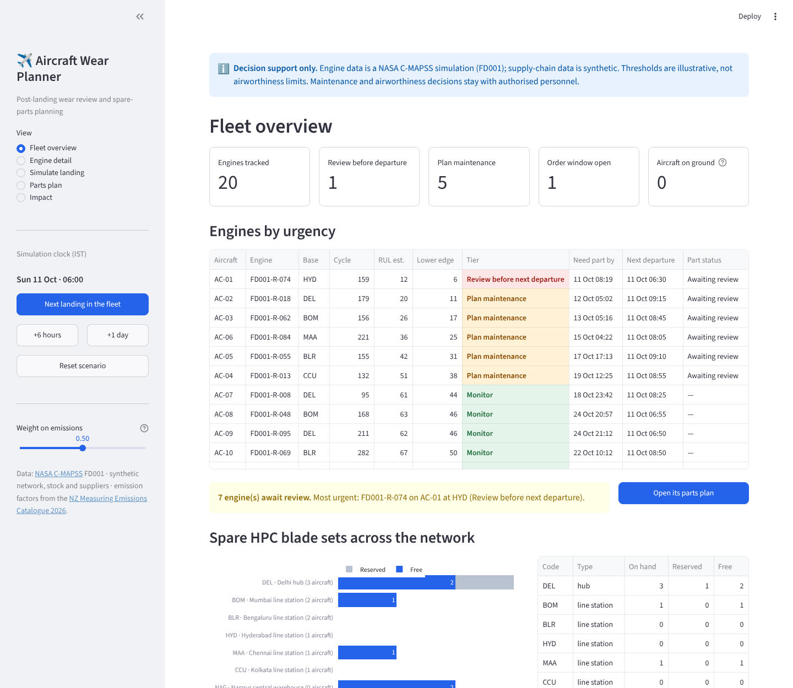
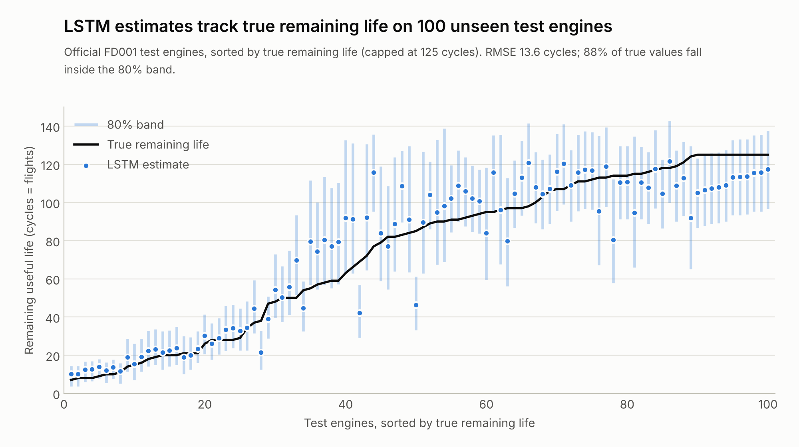
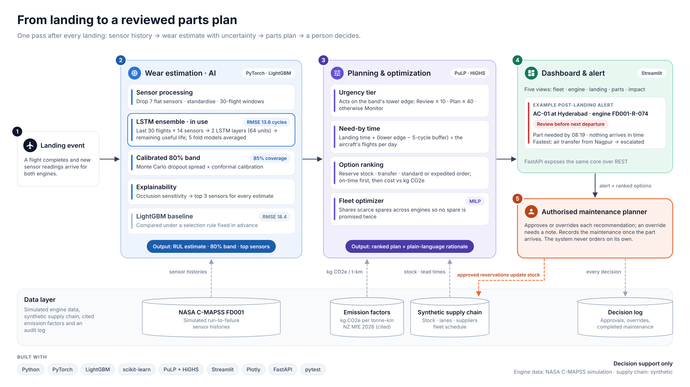

# Aircraft Wear Planner

**Predict wear before the next take-off.** After every landing, this prototype estimates how much useful
life an engine has left, with an honest uncertainty band, and turns that into a spare-parts plan:
reserve a local spare, transfer one, or order early, balancing time, cost and freight emissions.
A person approves every decision.

Theme: AI for Resilient and Sustainable Supply Chains · Round 2 submission


| Live Prototype URL | https://aircraft-wear-planner-hazf9ezmfmgncbjkdemhhv.streamlit.app/ |

| Demo video | https://youtu.be/xD5DGo3GbjE |

| Code | this repository |



> **Decision support only.** Engine data is the NASA C-MAPSS simulation (FD001). Supply-chain data is
> synthetic. Thresholds are illustrative, not airworthiness limits. Maintenance and airworthiness
> decisions stay with authorised personnel.

## What it does

1. **Estimates wear after each landing.** An LSTM sequence model reads the last 30 flights of 14 sensors and
   predicts remaining useful life (RUL) in flight cycles. Each estimate comes with a calibrated 80% band and
   the 3 sensors that drove it. On the same test engines it beat a LightGBM baseline (RMSE 13.6 against 18.4 cycles).
2. **Plans the part before the next departure.** The planner acts on the cautious lower edge of the band,
   converts cycles to a need-by time using each aircraft's flights per day, and ranks every way to get the
   part there: reserve local stock, transfer by road or air, or a standard or expedited supplier order.
3. **Shares scarce spares across the fleet.** When several engines want the same spares, a PuLP model
   (HiGHS solver) allocates them jointly so no spare is promised twice.
4. **Measures the effect instead of assuming it.** A replay of all 20 fleet engines compares the planner with
   waiting for failure, including the trade-off: life left unused when engines come off early.

## Results

All numbers come from running the code in this repository (the ML pipeline below, then the Impact view).

**Models** (simulated NASA C-MAPSS FD001 data; both use the same folds, metrics code and held-out engines)

| Measure | LightGBM baseline | LSTM, in use |
| --- | ---: | ---: |
| Test RMSE, 100 official test engines, last cycle (true RUL capped at 125) | 18.4 cycles | **13.6 cycles** |
| NASA PHM08 score on the same engines (lower is better) | 1,298 | **291** |
| 80% band coverage on 20 held-out engines, every cycle (target 80%) | 82% | 85% |
| Mean band width | 46 cycles | **38 cycles** |
| Review alert: median flights of notice (worst engine) | 17 (12) | 16 (12) |

The raw Monte Carlo dropout band covered only 70% of true values; conformal calibration brought it to 85%.
Method, charts and the selection rule: [docs/technical_approach.md](docs/technical_approach.md).



**Spare-parts policy, synthetic scenario** (same fleet, stock and suppliers; all 20 engines replayed to end of life)

| Measure | Reactive (wait for failure) | Predictive (this planner) |
| --- | ---: | ---: |
| Unscheduled removals | 20 | 0 |
| Hours aircraft wait on ground for parts (AOG) | 694.8 | 3.2 |
| Air shipments | 17 | 1 |
| Expedited orders | 14 | 0 |
| Parts cost incl. part value and logistics | $5,154,887 | $4,901,334 |
| Freight emissions | 2,131 kg CO2e | 193 kg CO2e |
| Mean life left unused at removal | 0 cycles | 9.9 cycles |

The scenario is synthetic: it shows the mechanism, not real-world savings. The remaining 3.2 AOG hours come from
one engine that is already in the review tier when the simulation starts, with no spare able to reach its base in time.

## Architecture



Details: [docs/architecture.md](docs/architecture.md) · Prototype walkthrough: [docs/prototype.md](docs/prototype.md)

## Run it locally

Python 3.13 (tested). From the repo root:

```bash
pip install -r requirements-dev.txt
python -m ml.baseline_model          # LightGBM baseline (about 40 s)
python -m ml.sequence_model          # LSTM ensemble (about 6 min on 2 CPU cores)
python -m ml.select_model            # compares both, promotes the winner to outputs/predictions.csv
python -m ml.make_charts             # charts in docs/images/
python -m ml.inference --engine FD001-T-003   # score one engine's history
python data/generate_synthetic.py    # regenerates the synthetic supply-chain tables (fixed seed)
streamlit run app/streamlit_app.py   # dashboard at http://localhost:8501
uvicorn api.main:app --reload        # optional REST API, docs at http://127.0.0.1:8000/docs
pytest -q                            # 32 tests: models, inference, planning rules, optimizer, simulations, API, dashboard
```

The repo already contains the trained models and their outputs, so the dashboard runs straight after
`pip install -r requirements.txt`.

## Deploy (Streamlit Community Cloud)

1. Push this repository to GitHub (public).
2. At [share.streamlit.io](https://share.streamlit.io), choose **Create app**, pick the repo, branch `main`
   and main file `app/streamlit_app.py`.
3. Under **Advanced settings**, choose Python 3.13, then deploy. `requirements.txt` holds only what the
   dashboard needs; model training is done offline.
4. Free apps sleep when idle: open the link before judging starts.

## Repository layout

```text
app/streamlit_app.py        dashboard (5 views)
api/main.py                 optional FastAPI layer over the same core
core/                       planning engine, optimizer, fleet and policy simulations
ml/                         data prep, LSTM and LightGBM models, selection, inference, charts
data/raw/                   NASA C-MAPSS FD001
data/synthetic/             synthetic network, stock, suppliers and fleet + generator
data/reference/             cited emission factors
outputs/                    predictions.csv (model -> planner contract), metrics, model comparison
models/                     trained LSTM ensemble, LightGBM model, band calibrations
docs/                       architecture, prototype walkthrough, screenshots
tests/                      pytest suite
config.yaml                 thresholds, buffer, weights, simulation start
```

## Method in brief

- **Data:** C-MAPSS FD001; 14 informative sensors; RUL labels capped at 125 cycles; one cycle is treated as one flight.
  20 training engines are held out entirely and replayed in the dashboard.
- **Models:** an LSTM (2 layers × 64 units) on the last 30 cycles of 14 sensors, trained as a 5-fold engine-wise
  ensemble, compared with a LightGBM baseline on 84 rolling features. A selection rule fixed in advance picked the LSTM.
- **Band:** Monte Carlo dropout gives each estimate a spread; per-range conformal calibration on out-of-fold errors
  turns it into an 80% band that covers 85% of true values on held-out engines, and narrows near end of life.
- **Explanation:** occlusion sensitivity names the top 3 sensors behind every estimate (TreeSHAP for the baseline).
- **Planner:** tiers on the lower edge (Review ≤ 10 cycles, Plan ≤ 40, otherwise Monitor); need-by = landing time +
  (lower edge − 5-cycle buffer) ÷ flights per day; on-time options scored by normalised cost and CO2e, weighted by a slider;
  if nothing is on time, the fastest option is escalated.
- **Emissions:** part weight × distance × kg CO2e per tonne-km by mode (road, short- and long-haul air with radiative
  forcing, container ship) from the [NZ Ministry for the Environment Measuring Emissions Catalogue 2026](https://measuringemissionsguide.environment.govt.nz/8_freight.html).

## Limitations

- Engine data is simulated (one operating condition, one fault mode); results are not validated on airline data.
- The supply-chain network, stock, prices, lead times and fleet schedule are synthetic.
- Each aircraft flies a fixed rotation from its base; parts are planned for that base.
- Thresholds are illustrative. Real limits come from approved maintenance programmes and authorised staff.

## Team

| Role | Name |
| --- | --- |
| ML lead | Soham & Arnav |
| Systems and prototype lead | Arnav |
| Research, content and demo lead | Aadhya |

## AI usage declaration

Generative AI (Claude, by Anthropic) helped write code, tests and documentation in this repository. All results
above were produced by running that code; the team reviewed the outputs. _Add any other tools the team used._

## Data and licence

NASA C-MAPSS data: see [data/raw/README.md](data/raw/README.md). Code: MIT licence.

## Problem Statement
Aircraft engines and their components experience gradual wear during operation. Identifying changes in engine health early is important because maintenance teams need sufficient time to assess maintenance requirements and arrange the necessary spare parts. When a maintenance requirement is identified late, the availability of components, supplier lead times, and logistics can make maintenance planning more difficult.

Traditional maintenance approaches may rely on scheduled inspections, operating limits, and existing maintenance records. Although these remain essential, data-driven techniques offer an additional way to study changes in component health over time. NASA's C-MAPSS dataset provides simulated engine sensor readings across operating cycles and is used in research on engine degradation and Remaining Useful Life (RUL) estimation.

## Proposed Solution
This project proposes an AI-assisted system that estimates gradual aircraft engine degradation using sensor data collected over completed operating cycles. Rather than focusing on detecting failures during a flight, the system is intended to support maintenance planning after landing and before the aircraft's next departure.

The proposed workflow begins by processing historical sensor readings to estimate engine health or Remaining Useful Life. The resulting estimate can then be used as an input to a maintenance-planning and spare-parts forecasting module. This module considers the anticipated maintenance requirement alongside factors such as part availability, inventory levels, supplier lead times, and transport options. The objective is to help maintenance and supply-chain teams identify potential parts requirements earlier and plan resources more effectively.

The project aims to connect AI-based degradation estimation with supply-chain decision support in a single workflow. Its initial demonstration will use available engine degradation data and, where necessary, clearly labelled synthetic supply-chain data. The system is a planning-support prototype: it does not certify an aircraft as safe to fly or replace approved maintenance procedures. All actual maintenance and airworthiness decisions must remain with qualified aviation professionals.

## Feasibility & Impact
**Technical Feasibility**
The project is feasible as an academic prototype because it combines established machine-learning methods with a comparatively simple planning workflow. Historical sensor readings can be prepared as time-series data, a baseline model can be trained to estimate Remaining Useful Life (RUL), and the model output can be passed to a rule-based or data-driven planning module. Feasibility is strongest for demonstrating the end-to-end concept. Demonstrating that the system is reliable enough for operational aviation use would require additional validated data, rigorous testing, and formal expert review.

**Expected Impact**
- **Earlier planning visibility:** Estimates of gradual degradation may help maintenance planners identify engines that warrant closer assessment after a completed flight.
- **Spare-parts readiness:** Forecasting possible maintenance needs may help teams review component availability before the next scheduled departure.
- **Better coordination:** Advance visibility may support coordination between maintenance teams, inventory managers, suppliers, and logistics teams.
- **Inventory decision support:** Demand estimates may help teams investigate potential stock shortages or excess inventory.
- **Potential reduction in avoidable urgent logistics:** Earlier planning could create opportunities to avoid some urgent shipments, but any improvement would need to be measured against a baseline.
- **Potential environmental benefit:** Fewer avoidable urgent shipments could reduce some transport impacts; this is a hypothesis, not a demonstrated outcome of the prototype.

## Limitations, Risks, and Safeguards
- **Simulated data:** C-MAPSS may not reflect all real engines, maintenance practices, environmental conditions, or sensor behaviours.
- **Prediction uncertainty:** Sensor noise, changing operating conditions, and differences between engines can reduce model accuracy.
- **Supply-chain assumptions:** Synthetic inventory and lead-time records are useful for demonstration but cannot prove real supplier performance or actual parts availability.
- **Safety boundary:** The model must not be used to certify airworthiness or independently authorise an aircraft to fly. Approved procedures and qualified professionals remain essential.

## Future Scope
- Validate the approach with appropriately authorised real engine and maintenance data, if available.
- Compare multiple models and report uncertainty, not only a single RUL estimate.
- Include component criticality, supplier reliability, procurement time, inventory costs, and logistics constraints in the planning module.
- Build a dashboard showing sensor trends, estimated RUL, assumptions, and potential parts requirements.
