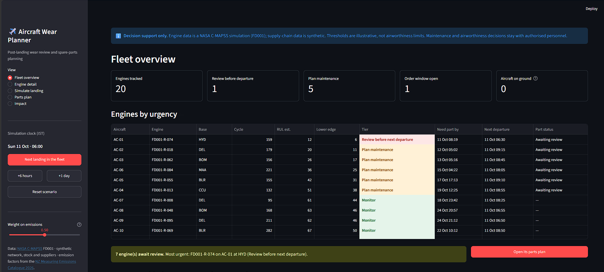
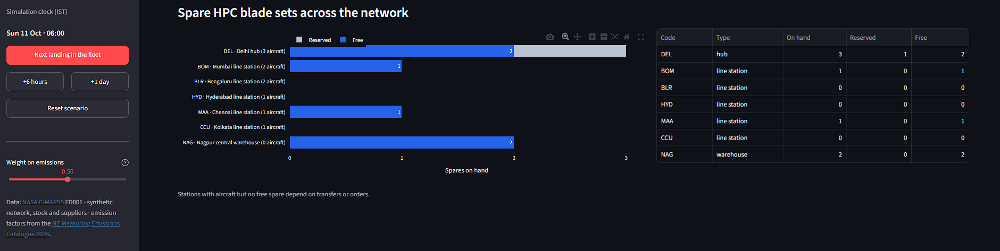
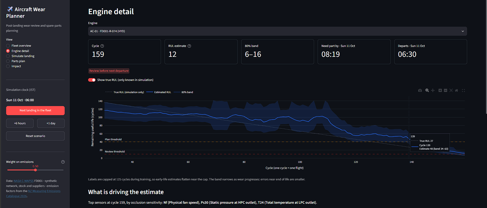
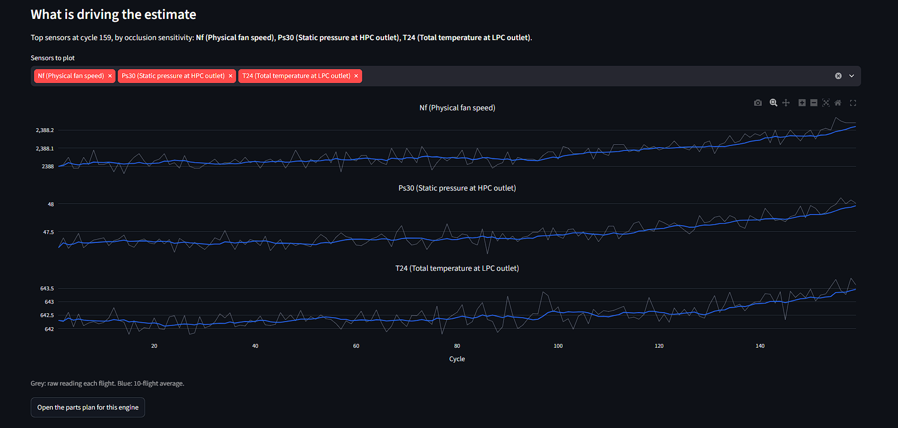
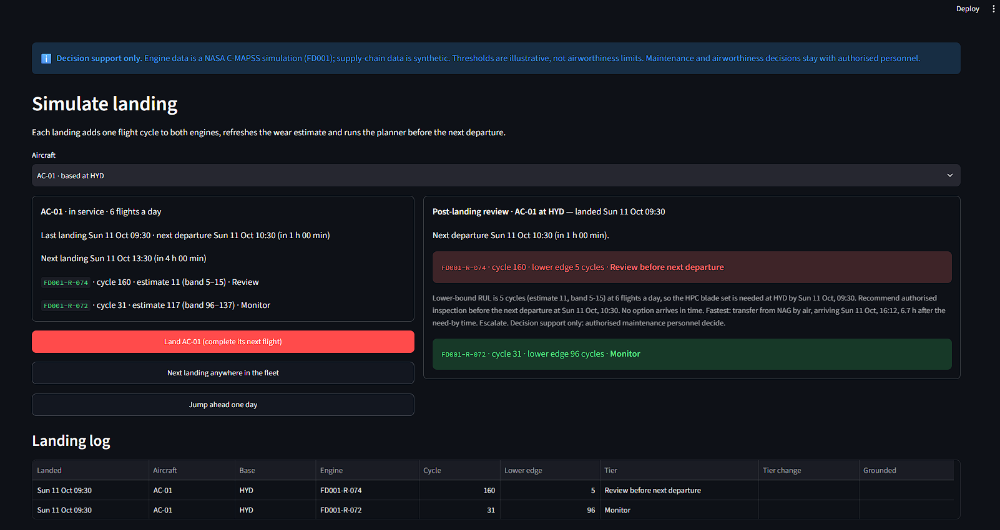
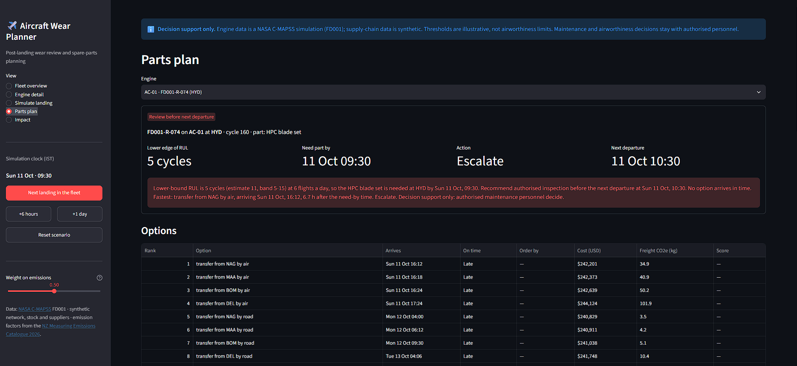
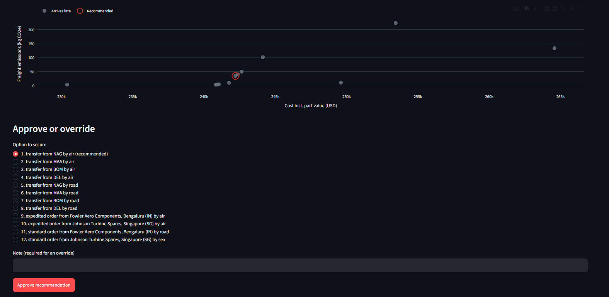
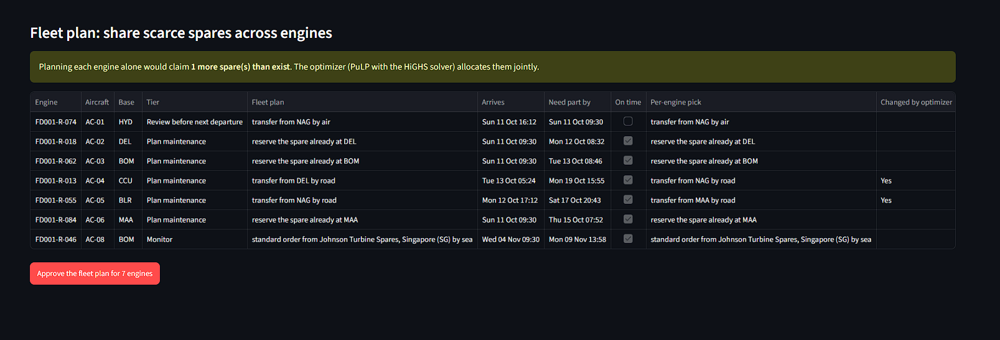
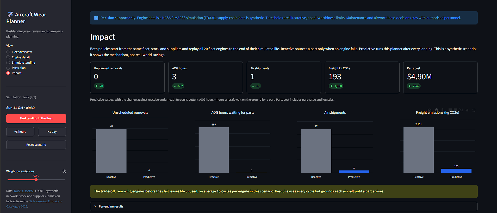
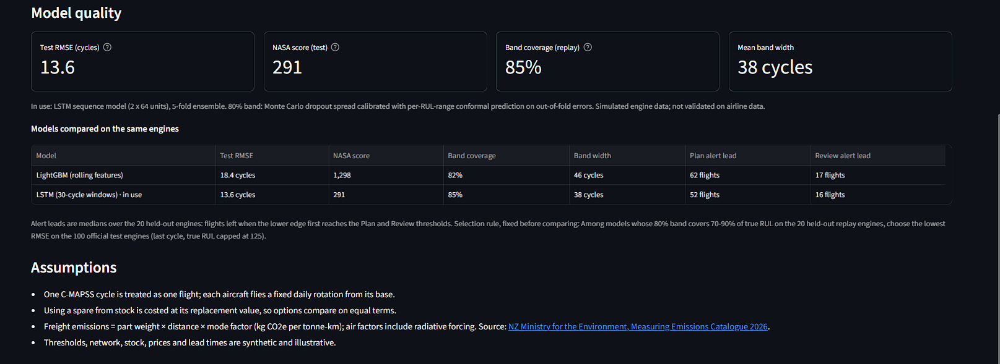

# Prototype

A working Streamlit dashboard runs the full loop from sensor data to an approved parts plan on a
synthetic fleet of 10 aircraft and 20 engines.

## Implemented functionality

| View | What works |
| --- | --- |
| Fleet overview | Engines ranked by urgency with estimate, lower edge, tier, need-by time, next departure and part status; tier counts; spare stock by location |
| Engine detail | RUL history with the 80% band, the true RUL line (simulation only) and the Review and Plan thresholds; top sensors with names; sensor trend charts |
| Simulate landing | Land one aircraft or the next in the fleet, or jump a day ahead; post-landing review card with tier changes, rationale and time to next departure; landing log; end of life grounds the aircraft |
| Parts plan | Recommendation with plain-language rationale; all options with arrival, on-time check, order-by time, cost, CO2e and score; cost-vs-CO2e chart; approve, override with a note, cancel, record maintenance; fleet plan from the optimizer with one-click approval; decision log |
| Impact | Reactive vs predictive comparison (unplanned removals, AOG hours, air shipments, CO2e, cost) with the unused-life trade-off; model quality metrics; LSTM vs LightGBM comparison; assumptions |

Also in the repository: the trained LSTM ensemble and LightGBM baseline with their metrics, `predict_rul()` for
scoring any engine history, the synthetic data generator, a FastAPI layer with interactive docs, and 32 automated
tests including headless runs of every dashboard view.

## Demo path (about 2 minutes of screen time)

1. **Fleet overview.** One engine (AC-01 at Hyderabad) needs review before its 06:30 departure, five are in the
   planning window, and only six spare HPC blade sets exist across the network.
2. **Engine detail** for AC-01's engine: the band narrowing towards the review threshold, the true RUL line,
   and the top sensors (fan speed, HPC static pressure, LPC outlet temperature).
3. **Simulate landing:** land AC-01. The review card shows the lower edge, the need-by time and the time to the
   next departure.
4. **Parts plan:** no option arrives in time at Hyderabad, so the planner escalates the fastest (air transfer from
   Nagpur) and states the shortfall. Approve it.
5. **Fleet plan:** planning each engine alone would promise more spares than exist. The optimizer reassigns them;
   approve the fleet plan in one click.
6. Pick **AC-08 · FD001-R-046 (BOM)** in the parts plan and move the **Weight on emissions** slider. At 0 (cost only)
   the planner orders the cheaper part by sea from Singapore; at 1 (emissions only) it reserves the spare already in
   Mumbai. Most options don't conflict, because slow freight is usually both cheaper and cleaner.
7. **Impact:** reactive vs predictive on the same fleet, ending on the trade-off (about 10 cycles of life left
   unused per engine), then the two models compared.

## Known limits

- Engine data is simulated; supply-chain data is synthetic; thresholds are illustrative.
- The simulation keeps state per browser session; **Reset scenario** returns to the start.
- Each aircraft is planned at its home base.

## Screenshots

