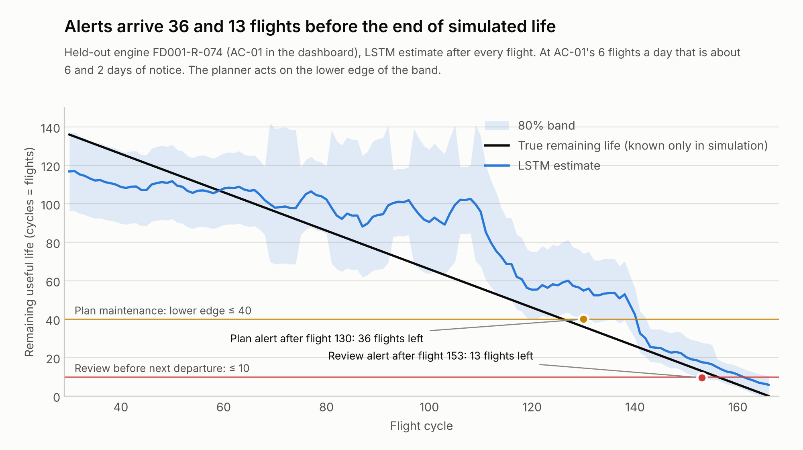
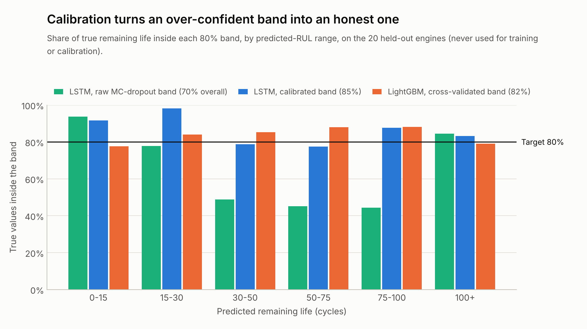
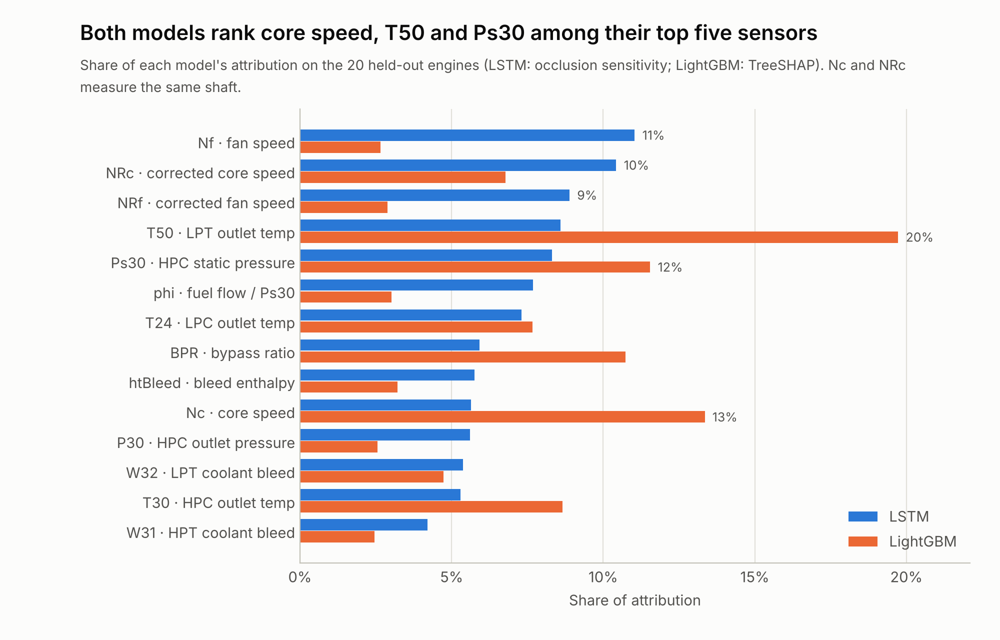

# Technical Approach

An LSTM sequence model reads the last 30 flights of 14 engine sensors and estimates remaining useful life (RUL)
with a calibrated 80% uncertainty band. A planning engine turns the cautious lower edge of that band into a
parts decision, and an optimizer shares scarce spares across the fleet. On the 100 official NASA test engines,
the LSTM's error is **13.6 cycles RMSE**, against **18.4** for a LightGBM baseline built and tested the same way.

All figures below come from running the code in this repository on simulated NASA C-MAPSS data. None are
airline results.

## Data

| Dataset | What it holds | How we use it |
| --- | --- | --- |
| [NASA C-MAPSS](https://data.nasa.gov/dataset/cmapss-jet-engine-simulated-data), subset FD001 | 100 training engines run to failure (20,631 cycles); 100 test engines stopped before failure (13,096 cycles) plus their true RUL; 21 sensors; one operating condition; one fault mode (high-pressure compressor degradation) | Engine wear. One cycle is treated as one flight |
| Synthetic supply chain (generated, fixed seed) | 7 locations, 5 parts, 10 suppliers, stock, transfer lanes, 10 aircraft with 20 engines | Parts planning, clearly labelled synthetic |
| [NZ Ministry for the Environment, Measuring Emissions Catalogue 2026](https://measuringemissionsguide.environment.govt.nz/8_freight.html) | kg CO2e per tonne-km for road, air (with radiative forcing) and sea freight | Emissions of each delivery option |

**Preparation.** Seven sensors are flat in FD001 and are dropped, leaving 14. RUL labels are capped at 125 cycles,
the standard piecewise-linear target for C-MAPSS. Data is split **by engine, never by row**:

- 80 engines train the models in 5 engine-wise folds.
- 20 engines are held out completely. They are never used for fitting, early stopping or calibration, so they
  give an honest check, and they are the engines replayed in the dashboard.
- The 100 official test engines are scored once, at their last cycle.

## Models

The round 1 brief proposed comparing a tree-based baseline with an LSTM. Both use the same folds, metrics
code and held-out engines.

| | LightGBM baseline | LSTM, in use |
| --- | --- | --- |
| Input | 84 features: each sensor's value, 5- and 10-cycle mean and spread, 10-cycle slope | The last 30 cycles of 14 standardised sensors |
| Model | Gradient-boosted trees (226 rounds) | 2 LSTM layers × 64 units → dense 32. Variational dropout 0.25, Adam, early stopping. The 5 fold models form an ensemble |
| 80% band | 10th–90th percentile of cross-validated errors in each predicted-RUL range | Monte Carlo dropout spread, calibrated with conformal prediction (below) |
| Explanation | TreeSHAP, exact for trees | Occlusion: each sensor's window is set to its average and the change in the estimate is measured |
| Training time on 2 CPU cores | About 40 seconds | About 6 minutes |

**Selection rule, fixed before comparing.** Among models whose band covers 70–90% of true RUL on the held-out
engines, the lowest test RMSE wins. The winner's predictions feed the planner and dashboard
(`ml/select_model.py`).

## Results

| Measure | LightGBM | LSTM |
| --- | ---: | ---: |
| Test RMSE, 100 official test engines (true RUL capped at 125) | 18.4 cycles | **13.6 cycles** |
| NASA PHM08 score, which penalises late estimates (lower is better) | 1,298 | **291** |
| RMSE on the 20 held-out engines, every cycle | 17.7 cycles | 14.2 cycles |
| 80% band coverage on held-out engines | 82% | 85% |
| 80% band coverage on test engines | 86% | 88% |
| Mean band width | 46 cycles | **38 cycles** |
| Plan alert: median flights left when it fires | 62 | 52 |
| Review alert: median flights left (worst engine) | 17 (12) | 16 (12) |

The LSTM is more accurate and has a narrower band that still covers more of the truth. Every held-out engine
was flagged for review at least 12 flights before its simulated end of life, under both models. The narrower
LSTM band means plan alerts arrive a little later (52 against 62 flights). Parts still arrive in time: the
policy simulation records no unscheduled removals, and less life is left unused.




## Uncertainty you can trust

Read as a normal distribution, the raw Monte Carlo dropout spread gives a band that covers only 70% of true
values on held-out engines, and just 44–49% between 30 and 100 cycles. Calibration fixes this. Within each
predicted-RUL range, the errors of the out-of-fold estimates, divided by their own spread, set how far the
band reaches below and above the estimate. In those mid ranges this widens the band about 1.6–2.0 times. Fixed
dropout masks make every estimate repeatable: `predict_rul()` reproduces the dashboard's numbers exactly.

| Predicted RUL range (cycles) | Raw MC-dropout band | LSTM, calibrated | LightGBM | Held-out rows |
| --- | ---: | ---: | ---: | ---: |
| 0–15 | 94% | 92% | 78% | 300 |
| 15–30 | 78% | 98% | 84% | 279 |
| 30–50 | 49% | 79% | 85% | 372 |
| 50–75 | 45% | 78% | 88% | 414 |
| 75–100 | 44% | 88% | 88% | 601 |
| 100+ | 85% | 83% | 79% | 1,695 |
| **All** | **70%** | **85%** | **82%** | 3,661 |



## Explainability

Every estimate in the dashboard names its three most influential sensors. Across the held-out engines, both
models rank core speed (Nc or its corrected form NRc), LPT outlet temperature (T50) and HPC static pressure
(Ps30) among their top five sensors. These are signals of the compressor degradation simulated in FD001. The
LSTM also leans on fan speed.



## From estimate to decision

- **Tiers on the lower edge.** Review before next departure at 10 cycles or fewer, plan maintenance at 40 or
  fewer, otherwise monitor. The thresholds are illustrative, not airworthiness limits.
- **Need-by time.** Landing time plus (lower edge − 5-cycle buffer) ÷ the aircraft's flights per day.
- **Options.** Reserve local stock, transfer by road or air, or place a standard or expedited order. Each option
  gets an arrival time, a cost and kg CO2e. On-time options are ranked by cost and emissions, weighted by a
  slider. If nothing arrives in time, the fastest option is escalated.
- **Fleet optimizer.** A mixed-integer program (PuLP with the HiGHS solver) assigns scarce spares across engines
  so none is promised twice.
- **Measured impact.** A replay of all 20 fleet engines compares the planner with waiting for failure. Results
  are in the [README](../README.md#results).

A person approves or overrides every recommendation.

## Technologies

| Area | Tools |
| --- | --- |
| Language and data | Python 3.13, pandas, NumPy, scikit-learn |
| Models | PyTorch (LSTM), LightGBM (baseline) |
| Optimization | PuLP with the HiGHS solver |
| App and API | Streamlit, Plotly, FastAPI |
| Quality | pytest (32 tests), fixed seeds, reproducible pipeline |
| Charts | matplotlib |
| Delivery | GitHub, Streamlit Community Cloud |

## Reproduce

```bash
pip install -r requirements-dev.txt
python -m ml.baseline_model     # LightGBM baseline, about 40 s
python -m ml.sequence_model     # LSTM ensemble, about 6 min on 2 CPU cores
python -m ml.select_model       # compares both, promotes the winner to outputs/predictions.csv
python -m ml.make_charts        # charts in docs/images/
python -m ml.inference --engine FD001-T-003   # score one engine
```

## Limitations

- The engine data is simulated, with one operating condition and one fault mode. Nothing has been validated on
  airline data.
- RUL is capped at 125 cycles, so early-life estimates are deliberately conservative.
- Occlusion measures sensitivity, not cause. Correlated sensors (for example Nc and NRc) share credit
  differently in the two models.
- The supply-chain data is synthetic, and the thresholds are illustrative. Real limits come from approved
  maintenance programmes and authorised staff.
